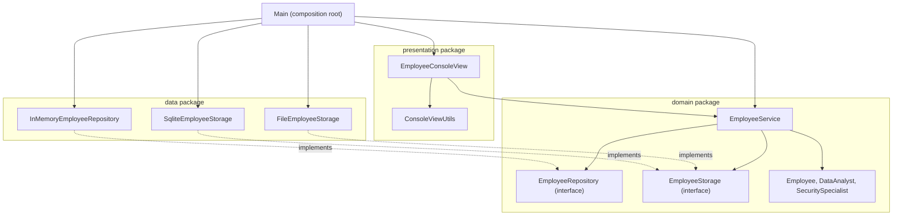
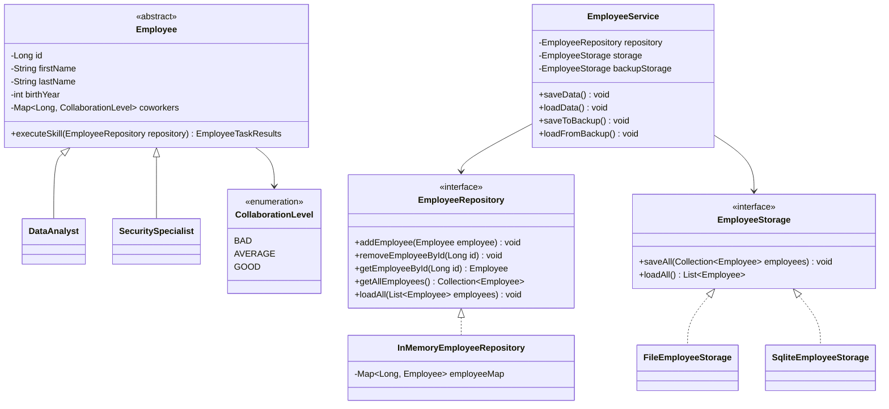

# Employee Management System & Risk Analysis Engine
[](https://github.com/MadovyGabor/DatabazovySystemZamestnancu/actions/workflows/ci.yml)


**Architecture & Engineering Overview**
> This project was developed as a university assignment. It is a console application with a layered structure, two storage backends (a text file and an SQLite snapshot), and a GitHub Actions workflow that runs the Gradle test task.

---

## System Architecture

The code is split into three layers. The domain package does not import the data or presentation packages. Storage and repository access go through the `EmployeeRepository` and `EmployeeStorage` interfaces, and `Main` creates the concrete implementations and passes them to `EmployeeService`.

- **Presentation layer** (`employee.presentation`): a text menu in `EmployeeConsoleView`, with input helpers in `ConsoleViewUtils`.
- **Domain layer** (`employee.domain`): `EmployeeService`, the two interfaces, the `Employee` model with its subclasses `DataAnalyst` and `SecuritySpecialist`, and the business and storage exceptions.
- **Data layer** (`employee.data`): `InMemoryEmployeeRepository` (a `HashMap` used as the working store), `FileEmployeeStorage` (a `;`-separated text file) and `SqliteEmployeeStorage` (an SQLite snapshot).



---

## Engineering Decisions & Trade-offs

### 1. Statistics Computed in Java
The statistics methods (`getMostFrequentCollaborationLevel`, `getEmployeeWithMostConnections`, `getEmployeeCountsByGroup`) iterate over the in-memory map in `InMemoryEmployeeRepository`. Level counts are kept in an `EnumMap`. SQL is used only to write and read the snapshot in `SqliteEmployeeStorage`; the code contains no aggregate SQL query.

### 2. Deterministic Tie-Breaking
Every tie rule in the code is explicit:
- **Most frequent collaboration level**: on a tie the worse level wins, checked in the order BAD, AVERAGE, GOOD (`InMemoryEmployeeRepository.java:24-25`).
- **Employee with the most connections**: on an equal count the higher ID wins (`InMemoryEmployeeRepository.java:185-186`).
- **DataAnalyst best match**: on an equal count of shared coworkers the higher ID wins (`DataAnalyst.java:66-67`).
- **SecuritySpecialist audit list**: sorted by risk, highest first, then by ID, ascending (`SecuritySpecialist.java:90-91`).

---

## Technical Features

- **Hybrid Persistence**: Working data lives in memory. It is written to `database.txt` (options i and k) and to the `employees.db` SQLite snapshot (option k). The snapshot is loaded at startup. The snapshot write runs in one transaction with commit and rollback (`SqliteEmployeeStorage.java:76-142`).
- **Backup Guard**: If the startup load from the SQLite snapshot fails, `EmployeeService` records the failure and `saveToBackup` throws `BACKUP_NOT_LOADED` instead of overwriting the snapshot. The exit path prints this error (`Main.java:79-83`).
- **Polymorphic Employee Skills**:
  - **DataAnalyst**: finds the coworker who shares the most coworkers with this analyst.
  - **SecuritySpecialist**: scores each direct coworker. A coworker with no links scores 100. Otherwise the score is the mean of the link values (GOOD 0, AVERAGE 50, BAD 100). A coworker with fewer than three links gets a penalty of 20. The score is capped at 100 (`SecuritySpecialist.java:58-77`).
- **Statistics & Analytics**: the employee with the most connections, the most frequent collaboration level, and the employee counts per group.
- **Type-Safe Data Transfer**: the records `AnalystResult`, `SecurityResult` and `ConnectionRisk` carry skill results between layers.
- **Error Handling**: `BusinessException` carries a `BusinessError`, and `StorageException` carries a `StorageError`.

---

## Usage

The program reads menu choices from standard input. Each choice is a letter from a to k.

| Option | Action | Details |
|---|---|---|
| a | Add employee | Group `D` (data analyst) or `B` (security specialist), first name, last name, birth year from 1900 to 2100. The ID is assigned automatically. |
| b | Add collaboration | Employee ID and coworker ID (`0` cancels), then a level: `1` BAD, `2` AVERAGE, `3` GOOD. The link is stored on both employees. |
| c | Remove employee | Removes the employee and all links to it. `0` cancels. |
| d | Find employee by ID | Prints the employee and the coworkers with their levels. |
| e | Run employee skill | Asks for an employee ID and runs that employee's skill. A data analyst prints the best match and the number of shared coworkers. A security specialist prints the average risk and a list of coworkers with their risk scores. Scores of 70 or more are marked `[CRITICAL]`, scores of 40 or more `[WARNING]`. |
| f | Alphabetical list by group | Lists data analysts and security specialists separately, sorted by last name and then first name. |
| g | Statistics | Prints the employee with the most connections and the most frequent collaboration level. |
| h | Employee counts by group | Prints the number of data analysts, security specialists and the total. |
| i | Save to text file | Writes all employees to `database.txt`, replacing its content. |
| j | Load from text file | Reads `database.txt` and replaces the in-memory data with its content. |
| k | Exit | Saves to `database.txt`, then saves to the `employees.db` SQLite snapshot, then exits. |

File access: at startup the program loads only the `employees.db` snapshot. `database.txt` is read only by option j and written by options i and k. Changes made in the menu stay in memory until option i or k is used. The program has no shutdown hook, so changes made after the last save are lost when it exits without option k.

---

## Data formats

### Text file (`database.txt`)

One employee per line:

```
id;groupId;firstName;lastName;birthYear;coworkerId=LEVEL,coworkerId=LEVEL
```

- `groupId` is `DA` (data analyst) or `SS` (security specialist).
- `LEVEL` is `BAD`, `AVERAGE` or `GOOD`. The coworker list may be empty.
- Blank lines are skipped. A line with fewer than six fields is reported as corrupted.

Example line with invented data:

```
7;DA;Anna;Nova;1990;12=GOOD,15=AVERAGE
```

### SQLite snapshot (`employees.db`)

The tables are created by `SqliteEmployeeStorage` if they do not exist (`SqliteEmployeeStorage.java:44-61`):

```sql
CREATE TABLE IF NOT EXISTS employees (
    id INTEGER PRIMARY KEY,
    type TEXT NOT NULL,
    first_name TEXT NOT NULL,
    last_name TEXT NOT NULL,
    birth_year INTEGER NOT NULL
);

CREATE TABLE IF NOT EXISTS coworkers (
    employee_id INTEGER NOT NULL,
    coworker_id INTEGER NOT NULL,
    collaboration_level TEXT NOT NULL,
    PRIMARY KEY (employee_id, coworker_id),
    FOREIGN KEY (employee_id) REFERENCES employees(id) ON DELETE CASCADE
);
```

The `type` column holds the group ID (`DA` or `SS`).

---

## Testing & Verification

The project defines 40 JUnit 5 tests in seven test classes. The counts are the number of `@Test` annotations in each file.

| Test class | Tests | Area |
|---|---|---|
| `ConsoleViewUtilsTest` | 2 | Name input validation |
| `EmployeeServiceTest` | 7 | Service rules and the backup guard |
| `InMemoryEmployeeRepositoryTest` | 8 | Repository queries and tie-breaking |
| `FileEmployeeStorageTest` | 9 | Text file format and errors |
| `SqliteEmployeeStorageTest` | 3 | SQLite snapshot save and load |
| Skills: `DataAnalystTest` and `SecuritySpecialistTest` | 11 (3 and 8) | DataAnalyst and SecuritySpecialist skills, including tie rules |

- Only `FileEmployeeStorageTest` uses JUnit's `@TempDir`. `SqliteEmployeeStorageTest` writes `test_employees.db` in the working directory.
- The GitHub Actions workflow (`.github/workflows/ci.yml`) runs on pushes and pull requests to `master`. It sets up JDK 21 (Temurin), runs `./gradlew test --no-daemon`, publishes the JUnit results and uploads the test report. The workflow has no deploy step.

```bash
# Run the test suite locally
./gradlew test
```

### Not covered by tests

- `EmployeeConsoleView` and `Main` have no tests.
- The SQLite rollback branch (`SqliteEmployeeStorage.java:142`) has no test.
- Write and I/O errors in `FileEmployeeStorage` have no test.

---

## Class Model



---

## Known Limitations

- Changes are kept in memory until option i or k. The program has no shutdown hook.
- Option i overwrites `database.txt` in place (`FileEmployeeStorage.java:51`).
- SQLite foreign keys are not enabled in the code, so `ON DELETE CASCADE` is not applied. Coworker rows of a removed employee can remain in the `coworkers` table (`SqliteEmployeeStorage.java:136`, which deletes only the employee rows).
- `database.txt` and `employees.db` are resolved against the working directory (`Main.java:19-20`).
- Names are checked only for the characters `;`, `,`, `=` and line breaks, and only when entered for option a (`ConsoleViewUtils.java`).
- Statistics scan all employees on each call.
- The program is a single-threaded console application with no synchronization.

---

## Setup & Installation

1. **Clone the Repository**:
   ```bash
   git clone https://github.com/MadovyGabor/DatabazovySystemZamestnancu.git
   cd DatabazovySystemZamestnancu
   ```

2. **Database Configuration**:
   The system uses an embedded **SQLite** database (`employees.db`) through `sqlite-jdbc`. No external server is required. The tables are created automatically if they do not exist. The text file `database.txt` is created by option i or k.

3. **Build the Project**:
   ```bash
   ./gradlew build
   ```

4. **Run the Application**:
   ```bash
   ./gradlew run
   ```
   The application reads menu input from standard input.

---

## Project Structure

- `org.example`: `Main`, the composition root and menu loop.
- `org.example.employee.presentation`: `EmployeeConsoleView` and `ConsoleViewUtils`, the console UI.
- `org.example.employee.domain`: `EmployeeService` and the `EmployeeRepository` and `EmployeeStorage` interfaces.
- `org.example.employee.domain.exceptions`: `BusinessException`, `BusinessError`, `StorageException` and `StorageError`.
- `org.example.employee.domain.model`: `Employee`, `CollaborationLevel` and `EmployeeTaskResults`.
- `org.example.employee.domain.model.employeeType.dataAnalyst`: `DataAnalyst` and `AnalystResult`.
- `org.example.employee.domain.model.employeeType.securitySpecialist`: `SecuritySpecialist`, `SecurityResult` and `ConnectionRisk`.
- `org.example.employee.data`: `InMemoryEmployeeRepository`, `FileEmployeeStorage` and `SqliteEmployeeStorage`.

Tests in `src/test/java` use the same package names.

---

## Contributions

Architecture and module structure (layers, repository/storage interfaces, composition root): Gabriel Madový.

Developed together with a project partner as a university team assignment.
