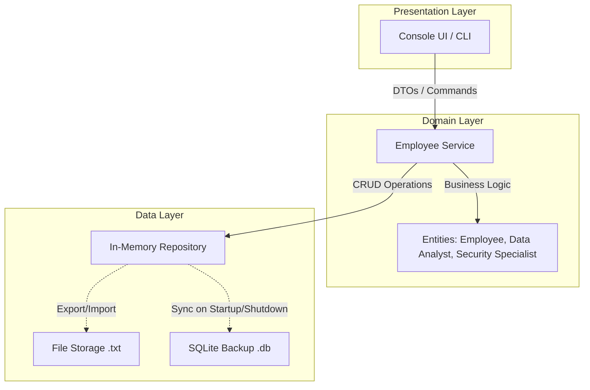
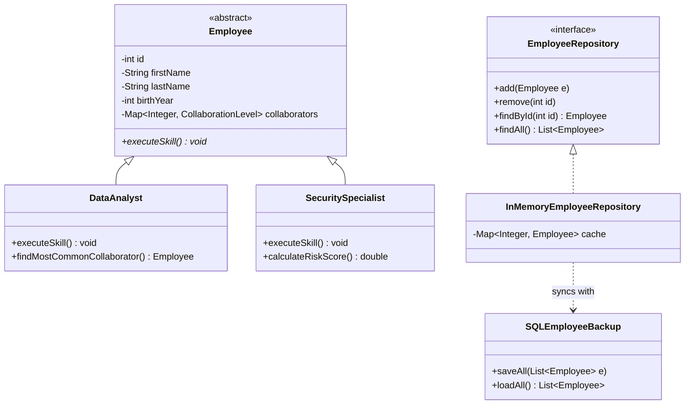

# Employee Management System & Risk Analysis Engine
[](https://github.com/MadovyGabor/DatabazovySystemZamestnancu/actions/workflows/ci.yml)


**Architecture & Engineering Overview**
> This project originated as a university assignment. It demonstrates strict separation of concerns, transactional persistence, and automated CI pipelines.

---

## System Architecture

The system uses a **Layered Architecture** with strict Separation of Concerns (SoC). Business logic is decoupled from infrastructure, so the Console UI can be replaced by a Web API, or the SQL backup by another storage backend, without altering core domain rules.

### The System Layers:
- **Presentation Layer**: A CLI-based interface focused on strict input validation and user experience.
- **Domain Layer**: Contains core business logic, polymorphic entities (Data Analysts, Security Specialists), and service orchestrators.
- **Data Layer**: A hybrid persistence model. It utilizes an In-Memory Cache for real-time performance and an SQLite/File-based synchronization mechanism for non-volatile storage.



---

## Engineering Decisions & Trade-offs

### 1. Query Optimization
Full dataset iteration in Java for every query was avoided.
- **Strategy**: Complex aggregations are delegated to the SQL engine where possible; otherwise Java Streams are used for in-memory processing.
- **Result**: Reduced CPU cost and stable performance as the dataset grows.

### 2. Deterministic Tie-Breaking
Network auditing produced non-deterministic results when two employees had an identical number of connections.
- **Issue**: Standard `max()` returns an arbitrary entry on a tie, which is unacceptable for audit data.
- **Fix**: Added a deterministic secondary comparison key by ID, so the output is always stable.

### 3. Architecture vs. Language Features
- **Trade-off**: Java 17 sealed interfaces were considered for employee types but constrained the package structure.
- **Decision**: Standard interfaces and abstract classes were chosen to preserve decoupling and a multi-package layout.

---

## Technical Features

- **Hybrid Persistence Model**: In-memory performance with SQL backup on shutdown. The application can run offline or sync with the local SQLite database.
- **Polymorphic Employee Skills**:
  - **Data Analysts**: Capable of executing algorithms to determine which collaborator shares the most mutual connections.
  - **Security Specialists**: Utilize a custom, weighted risk-scoring algorithm factoring in the number of connections, average connection quality (Poor, Average, Good), and isolation penalties for nodes with few connections.
- **Statistics & Analytics**: Lookup of the prevailing collaboration quality and the most connected employees.
- **Type-Safe Data Transfer**: Java Records provide immutable data transfer between layers.
- **Error Handling**: A custom exception hierarchy with clear error reporting.

---

## Testing & Verification

Deterministic behavior is verified through automated tests:
- **Unit & Boundary Testing**: 23 automated tests covering persistence edge cases (corrupted records, schema faults, empty datasets) and core domain logic.
- **Isolated I/O Testing**: Uses JUnit 5 `@TempDir` to execute disk operations in ephemeral sandboxes without polluting local storage.
- **Automated CI/CD Pipeline**: GitHub Actions workflow running on every push and pull request to `master`, enforcing regression checks across the entire test matrix.

```bash
# Run the test suite locally
./gradlew test
```

---

## Class Model



---

## Setup & Installation

1. **Clone the Repository**:
   ```bash
   git clone <repository-url>
   cd DatabazovySystemZamestnancu
   ```

2. **Database Configuration**:
   The system uses an embedded **SQLite** database (`employees.db`). No external server setup (like MySQL or PostgreSQL) is required. The database schema and tables will be initialized automatically if they do not exist.

3. **Build the Project**:
   ```bash
   ./gradlew build
   ```

4. **Run the Application**:
   ```bash
   ./gradlew run
   ```
